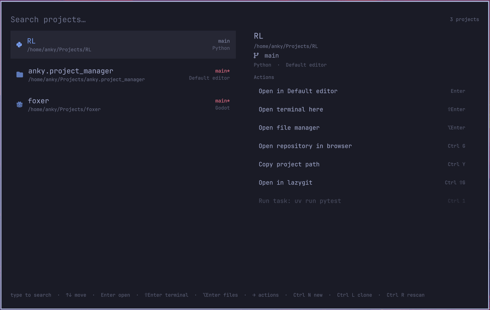

# Project Manager

A keyboard-driven project launcher for the [Omarchy](https://omarchy.org) shell.
Summon an overlay, type to filter your projects, and open any of them in your
editor, a terminal, or your file manager — with live git status, one-key jumps
to the repo, per-project tasks, and frecency ranking of what you actually use.



It is an Omarchy *overlay* plugin (same kind as the built-in clipboard) whose
styling derives from `omarchy.clipboard`, so it shares the `[menu]` theme
tokens. It runs as its own plugin — the clone metadata is intentionally **not**
declared — so the clipboard's own `SUPER + CTRL + V` keeps working.

## Features

- **Discovery** — recursively scans configured roots (default `~/Projects`) for
  git repositories and Godot projects (`project.godot`), plus any explicit
  entries from the config file.
- **Project types** — each project is tagged by the files it contains (Node,
  Rust, Go, Python, Nix, CMake, Ruby, PHP, Make, Just, Godot) and shown with a
  matching icon/label.
- **Auto-detected tasks** — project tasks are read straight from `package.json`
  scripts, `Makefile`/`justfile` targets, and `Cargo.toml`/`go.mod`/`pyproject`
  markers, so most projects need no task config. Tasks with a missing tool are
  greyed out.
- **Omarchy default editor** — by default projects open with whichever editor
  you selected via `omarchy default editor` (through `omarchy-launch-editor`),
  so the plugin follows that choice automatically.
- **Many editors** — VS Code, Zed, Cursor, Neovim (opens in a terminal), and
  Godot built in; add your own. Unavailable editors are shown greyed out, and
  `Ctrl+E` cycles the editor for the current project.
- **Godot projects** — anything with a `project.godot` opens in the Godot editor
  automatically (when `godot` is installed), unless you set an editor for it.
- **Terminal & files** — open a terminal in the project dir (`Shift+Enter`) or
  the file manager (`Alt+Enter`).
- **Git at a glance** — branch, dirty marker, ahead/behind counts in the list and
  detail pane.
- **lazygit** — any git repo gets a single "Open in lazygit" action (enabled when
  `lazygit` is installed), also bound to `Ctrl+Shift+G`.
- **Clone & create** — `Ctrl+L` clones a repo into your first discovery root;
  `Ctrl+N` scaffolds a new project (`mkdir` + `git init`).
- **Browser & clipboard** — `Ctrl+G` opens the repository remote; `Ctrl+Y` copies
  the project path.
- **Fuzzy search** — filter matches on name, path, tags, editor and branch as a
  subsequence, with matches highlighted.
- **Tasks** — auto-detected and per-project commands run in a terminal (output
  visible) with `Ctrl+1`..`Ctrl+9`.
- **Frecency** — the projects you open most, most recently, float to the top.

## Install

Add the plugin straight from GitHub:

```sh
omarchy plugin add https://github.com/Anky209e/omarchy-project_manager.git --enable
```

`omarchy plugin add` clones the repo into
`~/.config/omarchy/plugins/io.github.anky209e.project-manager`, validates the
manifest, and (with `--enable`) turns it on. It never runs anything from the
plugin and never asks for `sudo`.

> **Plugins run unsandboxed.** A plugin is code that runs inside the long-lived
> Omarchy shell process with your user permissions. Only install repositories
> you trust, and read them first if you are unsure.

If you installed without `--enable`, enable it later:

```sh
omarchy plugin enable io.github.anky209e.project-manager
```

### Bind a key

The plugin has no bar widget — it is summoned through the shell. Add a binding
to `~/.config/hypr/bindings.lua`:

```lua
o.bind("SUPER + ALT + P", "Project manager", "omarchy-shell shell toggle io.github.anky209e.project-manager")
```

Then reload Hyprland (`hyprctl reload`). The same `toggle` command can be bound
anywhere, run from a script, or invoked directly.

Optionally, give the overlay a stable layer namespace rule in
`~/.config/hypr/looknfeel.lua` so it animates/rounds like the rest of the shell
— the overlay uses the namespace `omarchy-project-manager`.

### Update

```sh
omarchy plugin update io.github.anky209e.project-manager
```

### Remove

```sh
omarchy plugin remove io.github.anky209e.project-manager
```

Removal deletes the plugin folder only. Your config
(`~/.config/omarchy/project-manager.json`) and frecency state
(`~/.local/state/omarchy/project-manager/usage.json`) are left untouched.

## Requirements

- Omarchy shell with third-party plugins enabled (Quattro).
- `bash`, `git`, `jq` (for the scan helper).
- For actions: `wl-copy`, `xdg-open`, `xdg-terminal-exec`,
  `omarchy-launch-browser`. Actions whose tool is missing are disabled, not
  broken.

The plugin is self-contained: no install hook, no `sudo`, no network access of
its own. It shells out only to the tools listed above (and to the editors /
tasks you configure).

## Development

Clone the repo and symlink it into your user plugin directory so edits are live:

```sh
git clone https://github.com/Anky209e/omarchy-project_manager.git ~/Projects/omarchy-project_manager
ln -sfn ~/Projects/omarchy-project_manager ~/.config/omarchy/plugins/io.github.anky209e.project-manager
omarchy-shell shell rescanPlugins
omarchy plugin list        # should list io.github.anky209e.project-manager
omarchy plugin validate ~/Projects/omarchy-project_manager
omarchy plugin enable io.github.anky209e.project-manager
```

> **Reloading while developing:** the plugin directory is a symlink, so the
> shell's file watcher does not see edits. After changing any plugin file run
> `omarchy restart shell` to pick them up (`omarchy-shell shell rescanPlugins`
> only re-reads plugin folders).

## Keybindings

| Key | Action |
| --- | --- |
| `SUPER + ALT + P` | Toggle the overlay |
| type | Filter projects |
| `Up` / `Down` | Move selection (or the action list when focused) |
| `Left` / `Tab` | Focus the action list |
| `Right` / `Shift+Tab` | Back to the project list |
| `Enter` | Open the highlighted action (default: editor) |
| `Shift+Enter` | Open a terminal in the project |
| `Alt+Enter` | Open the file manager |
| `Ctrl+E` | Cycle editor for the current project |
| `Ctrl+G` | Open the repository in the browser |
| `Ctrl+Shift+G` | Open the repo in lazygit |
| `Ctrl+Y` | Copy the project path |
| `Ctrl+N` | New project (name prompt) |
| `Ctrl+L` | Clone a repository (URL prompt) |
| `Ctrl+R` | Rescan projects |
| `Ctrl+1`..`Ctrl+9` | Run the nth task |
| `PageUp` / `PageDown`, `Home` / `End` | Jump within the list |
| `Esc` | Clear the filter, then leave the actions, then close |
| mouse | Hover/click select; double-click opens the default action |

## Configuration

User config: `~/.config/omarchy/project-manager.json` (optional; see
`config.example.json`). Everything has sensible defaults, and the file is
watched — saving it reloads live. Frecency state is kept separately in
`~/.local/state/omarchy/project-manager/usage.json`.

```json
{
  "version": 1,
  "defaultEditor": "omarchy",
  "scale": 0,
  "tasksInTerminal": true,
  "discovery": {
    "enabled": true,
    "roots": ["~/Projects", "~/Work", "~/dev"],
    "maxDepth": 3,
    "exclude": ["node_modules", ".git", ".venv", "dist", "build", "target"]
  },
  "editors": {
    "omarchy": { "label": "Default editor", "command": "omarchy-launch-editor", "args": ["{path}"], "kind": "direct" },
    "vscode":  { "label": "VS Code", "command": "code", "args": ["{path}"], "kind": "gui" },
    "nvim":    { "label": "Neovim",  "command": "nvim", "args": ["{path}"], "kind": "terminal" },
    "godot":   { "label": "Godot",   "command": "godot", "args": ["--path", "{path}", "--editor"], "kind": "gui" }
  },
  "projects": [
    {
      "name": "omarchy-project_manager",
      "path": "~/Projects/omarchy-project_manager",
      "editor": "nvim",
      "tags": ["omarchy", "qml"],
      "pinned": true,
      "tasks": {
        "Validate": "omarchy plugin validate .",
        "Git status": "git status"
      }
    }
  ]
}
```

### Fields

- **`discovery.enabled`** — turn auto-discovery off to use only `projects`.
- **`discovery.roots`** — directories to scan (supports `~`).
- **`discovery.maxDepth`** — recursion depth (minimum 1).
- **`discovery.exclude`** — directory names to skip anywhere in the tree.
- **`defaultEditor`** — editor id used when a project doesn't specify one. The
  built-in `omarchy` editor delegates to `omarchy-launch-editor`, so it follows
  your Omarchy default. A project with a `project.godot` still opens in Godot
  (when installed) unless it sets its own `editor`.
- **`scale`** — UI scale for the overlay. `0` (default) auto-scales by logical
  screen height so it stays comfortable on 1440p/4K displays (`1080p` → `1.0`,
  `1440p` → `1.33`, capped at `1.6`); set a number to force a fixed multiplier.
- **`tasksInTerminal`** — run tasks in a terminal window so their output is
  visible (`true`, default). Set `false` to run them detached in the background.
- **`editors[id]`** — `{ label, command, args, kind }`. `kind` is `"gui"` (launch
  via `uwsm-app`), `"terminal"` (run inside `xdg-terminal-exec`), or `"direct"`
  (run the command as-is, e.g. a launcher wrapper). `{path}` in `args` is
  replaced with the project path.
- **`projects[]`** — `{ name?, path, editor?, tags?, pinned?, tasks? }`. `path`
  supports `~`; `name` defaults to the basename. `pinned` projects always sort
  first. `tasks` is a name→command map (or a list of `{name, command}`).

## How it works

| File | Role |
| --- | --- |
| `ProjectManager.qml` | The overlay: window, list, detail/actions pane, key handling, processes and file I/O. |
| `ProjectStore.js` | All pure logic (config normalization, scan args, parsing, merge/rank/filter, action + command building, frecency). No Qt types, so it is unit-testable with plain `node`. |
| `project-manager.sh` | Scan helper: walks the roots, reports git branch/dirty/ahead/behind and remote, detects project types (`package.json`, `Cargo.toml`, `go.mod`, …) and generates tasks from `package.json` scripts / `Makefile` / `justfile` / tool markers, and lists which editor/action commands exist on `$PATH`. Emits JSON. |
| `manifest.json` | Plugin manifest (`overlay` kind, `keepLoaded`). |
| `config.example.json` | Sample user config. |

Architecture: `ProjectManager.qml` owns side effects; every decision — what to
scan, how to rank, which command to run — is delegated to `ProjectStore.js`,
which the QML imports as `Store`. `project-manager.sh` is invoked only to do
filesystem + git discovery in one fast pass.

## License

[MIT](LICENSE) © 2026 Ankit Kumar (anky209e)
